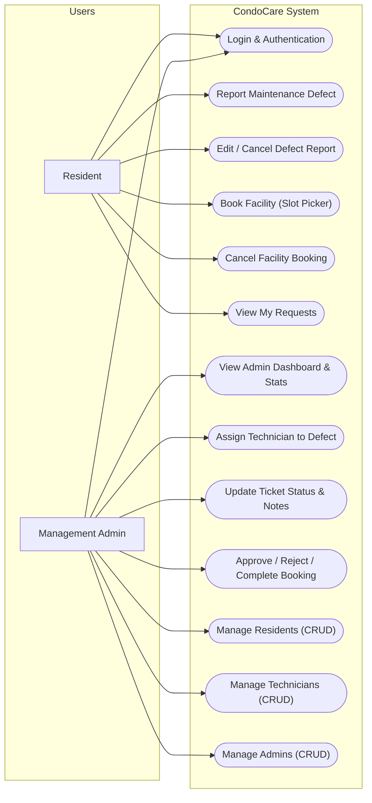
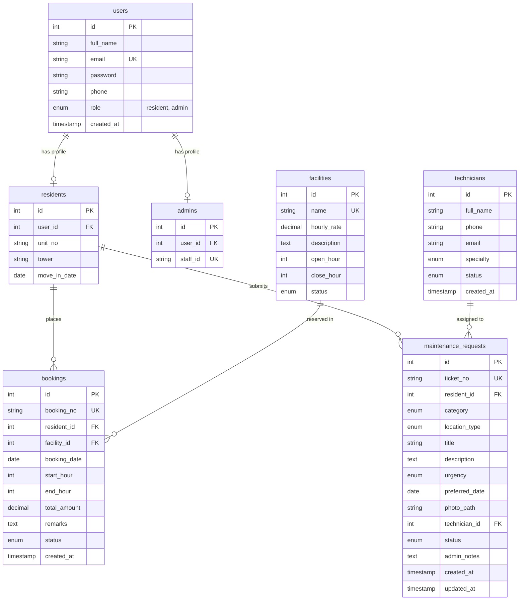

# CondoCare - Condominium Maintenance & Facility Booking System
## Coursework Documentation Report
**Module:** DCS2102 Rapid Application Development  
**Programme:** Diploma in IT & Diploma in Computer Science  
**Technology Stack:** HTML5, CSS3, JavaScript (ES6), PHP 8.2, MySQL, Apache (XAMPP)

---

## 1. Introduction
In multi-unit residential communities such as condominiums, property management offices face numerous logistical challenges regarding communication with residents, maintenance requests, and shared amenity management. Traditional manual methods, such as paper logbooks, phone calls, or unorganized messaging apps, often result in lost requests, scheduling conflicts, delayed repairs, and a lack of accountability.

**CondoCare** is a web-based information management system designed to streamline condominium operations. It bridges the gap between condominium residents and the property management team, providing a centralized platform for reporting maintenance defects, booking shared recreational facilities, tracking ticket lifecycles, and managing residential units and maintenance staff.

---

## 2. Problem Statement
1. **Inefficient Defect Logging:** Residents reporting physical defects (e.g., plumbing leaks, broken hallway lights, elevator issues) via phone or physical complaint books frequently experience miscommunication and misplaced records.
2. **Double-Booking & Manual Coordination:** Common amenities like function halls, BBQ pits, and badminton courts often suffer from scheduling overlap or double bookings due to a lack of a real-time availability calendar.
3. **Lack of Status Visibility:** Residents have no convenient way to track whether their maintenance reports have been assigned to a technician, are currently under repair, or have been resolved.
4. **Disorganized Administration:** Property management lacks an integrated dashboard displaying key operational metrics such as open repair tickets, daily facility usage, and technician workloads.

---

## 3. Objectives
- To develop an interactive and intuitive web platform using HTML5, CSS3, and JavaScript.
- To implement server-side business logic and authentication using PHP and MySQL.
- To provide complete **CRUD (Create, Read, Update, Delete)** operations for key condominium entities:
  - Maintenance & Defect Requests
  - Facility Bookings
  - Resident Profiles
  - Maintenance Technicians
  - Administrative Staff
- To implement intelligent scheduling and dynamic rate calculation to eliminate double-booking conflicts.
- To ensure data integrity, robust validation (both client-side and server-side), and protection against SQL injection using PDO prepared statements.

---

## 4. Target Users
1. **Residents:**
   - Log in with residential email and password.
   - Submit maintenance defect requests with category, location, urgency, preferred inspection date, and optional photo attachment.
   - Reserve condominium facilities with interactive time slot selection and live cost calculation.
   - View history and status of all personal requests.
   - Cancel or edit requests prior to technician assignment or booking date.

2. **Management / Administrators:**
   - Access real-time analytics dashboard (open tickets, in progress, resolved this month, bookings today, facility usage distribution).
   - Review and assign maintenance tickets to specialized technicians (Plumbing, Electrical, Air-con, General, Lift).
   - Update repair status and enter inspection notes.
   - Approve, reject, or mark facility bookings as completed (used).
   - Perform full CRUD operations on residents, technicians, and administrators.

---

## 5. System Requirements

### 5.1 Hardware Requirements
- **Processor:** Intel Core i3 / AMD Ryzen 3 or higher
- **Memory (RAM):** Minimum 4 GB (8 GB recommended)
- **Disk Storage:** At least 500 MB free storage for XAMPP and database files

### 5.2 Software Requirements
- **Operating System:** Windows 10 / 11, macOS, or Linux
- **Local Server Stack:** XAMPP (Apache 2.4+, MySQL/MariaDB 10.4+, PHP 8.0+)
- **Database Management Tool:** phpMyAdmin / MySQL CLI
- **Modern Web Browser:** Google Chrome, Microsoft Edge, or Mozilla Firefox
- **Code Editor:** Visual Studio Code / Notepad++

---

## 6. System Design & Architecture

CondoCare is structured on a 3-tier web architecture:
1. **Presentation Layer (Frontend):**
   - HTML5 for structured semantic markup.
   - CSS3 with modern CSS grid, flexbox layout, status badges, chips, and responsive breakpoints.
   - JavaScript (ES6) for DOM manipulation, client-side input validation, dynamic cost calculation, consecutive slot validation, and interactive detail modals.
2. **Application / Business Logic Layer (PHP):**
   - Session authentication with role-based access control (RBAC).
   - Data sanitization and server-side validation.
   - PDO database abstraction with prepared queries.
   - REST-style JSON API (`api/get-booked-slots.php`) for asynchronous slot conflict detection.
3. **Data Layer (MySQL):**
   - Relational database schema (`condocare_db`) with foreign key constraints, indexes, and referential integrity (`CASCADE` / `SET NULL`).

---

## 7. Use Case Diagram

---

## 8. Entity-Relationship Diagram (ERD)

---

## 9. Database Design & Data Dictionary

### Table 1: `users`
| Column | Data Type | Key | Description |
|---|---|---|---|
| `id` | INT AUTO_INCREMENT | PK | Unique user ID |
| `full_name` | VARCHAR(100) | | User's full name |
| `email` | VARCHAR(100) | UNIQUE | User login email |
| `password` | VARCHAR(255) | | Bcrypt hashed password |
| `phone` | VARCHAR(25) | | Contact phone number |
| `role` | ENUM('resident','admin') | | System role |
| `created_at`| TIMESTAMP | | Timestamp of registration |

### Table 2: `residents`
| Column | Data Type | Key | Description |
|---|---|---|---|
| `id` | INT AUTO_INCREMENT | PK | Unique resident record ID |
| `user_id` | INT | FK | References `users(id)` ON DELETE CASCADE |
| `unit_no` | VARCHAR(20) | | Condominium unit (e.g. A-12-03) |
| `tower` | VARCHAR(20) | | Tower (e.g. Tower A, Tower B) |
| `move_in_date` | DATE | | Date resident moved in |

### Table 3: `admins`
| Column | Data Type | Key | Description |
|---|---|---|---|
| `id` | INT AUTO_INCREMENT | PK | Unique admin ID |
| `user_id` | INT | FK | References `users(id)` ON DELETE CASCADE |
| `staff_id` | VARCHAR(30) | UNIQUE | Management staff ID (e.g. ST-001) |

### Table 4: `technicians`
| Column | Data Type | Key | Description |
|---|---|---|---|
| `id` | INT AUTO_INCREMENT | PK | Unique technician ID |
| `full_name` | VARCHAR(100) | | Technician name |
| `phone` | VARCHAR(25) | | Phone number |
| `email` | VARCHAR(100) | | Technician email address |
| `specialty` | ENUM | | Plumbing, Electrical, Air-con, General, Lift |
| `status` | ENUM | | Active, Inactive |

### Table 5: `facilities`
| Column | Data Type | Key | Description |
|---|---|---|---|
| `id` | INT AUTO_INCREMENT | PK | Unique facility ID |
| `name` | VARCHAR(100) | UNIQUE | Name of amenity |
| `hourly_rate` | DECIMAL(8,2) | | Hourly booking rate in MYR (RM) |
| `description` | TEXT | | Facility overview and rules |
| `open_hour` | INT | | Opening hour (8 = 8 AM) |
| `close_hour`| INT | | Closing hour (22 = 10 PM) |
| `status` | ENUM | | Available, Maintenance |

### Table 6: `bookings`
| Column | Data Type | Key | Description |
|---|---|---|---|
| `id` | INT AUTO_INCREMENT | PK | Booking primary key |
| `booking_no` | VARCHAR(25) | UNIQUE | Unique identifier (e.g. BK-0231) |
| `resident_id`| INT | FK | References `residents(id)` |
| `facility_id`| INT | FK | References `facilities(id)` |
| `booking_date`| DATE | | Date of reservation |
| `start_hour` | INT | | Starting hour (8 to 21) |
| `end_hour` | INT | | Ending hour (9 to 22) |
| `total_amount`| DECIMAL(8,2) | | Calculated total price (Hours $\times$ Rate) |
| `remarks` | TEXT | | Special requests or remarks |
| `status` | ENUM | | pending, approved, cancelled, completed, rejected |

### Table 7: `maintenance_requests`
| Column | Data Type | Key | Description |
|---|---|---|---|
| `id` | INT AUTO_INCREMENT | PK | Ticket primary key |
| `ticket_no` | VARCHAR(25) | UNIQUE | Unique defect ticket (e.g. MT-0145) |
| `resident_id`| INT | FK | References `residents(id)` |
| `category` | ENUM | | Plumbing, Electrical, Air-con, Lift, Other |
| `location_type`| ENUM | | My unit, Common area |
| `title` | VARCHAR(150) | | Brief problem summary |
| `description` | TEXT | | Detailed defect explanation (max 500 chars) |
| `urgency` | ENUM | | Low, Medium, High |
| `preferred_date`| DATE | | Preferred inspection date |
| `photo_path` | VARCHAR(255) | | Relative path to uploaded image file |
| `technician_id`| INT | FK | References `technicians(id)` |
| `status` | ENUM | | reported, review, progress, resolved, cancelled |
| `admin_notes` | TEXT | | Maintenance findings & action notes |

---

## 10. Interface Design
- **Consistent Navigation Top Bar:** Displays CondoCare branding, contextual navigation links (resident vs admin), active state indicators, user greeting with unit/staff ID, and quick logout.
- **Responsive Layout:** CSS Grid and Flexbox support mobile devices, tablets, and full desktop displays without layout breaking.
- **Status Chips & Color Codes:** Clear status representation across tables (Yellow: Pending/Reported, Light Blue: Under review/In progress, Green: Approved/Resolved/Completed, Red: Cancelled/Rejected).
- **Interactive Modals:** Clean pop-ups for reading full request details, assigning technicians, and updating repair statuses without navigating away from the page.

---

## 11. Implementation Details

### 11.1 Security Implementations
- **Prepared Statements:** All database queries utilize PDO prepared statements with parameter binding, completely eliminating SQL injection risks.
- **Role-Based Access Control:** Secure session checks verify whether the authenticated user has authorization for the requested page (`requireRole('resident')` and `requireRole('admin')`).
- **XSS Sanitization:** User output is filtered with `e()` (wrapper around `htmlspecialchars(..., ENT_QUOTES, 'UTF-8')`).
- **File Upload Protection:** Uploaded images are checked for file size ($\le 5\text{ MB}$), MIME type, and safe extensions (`jpg`, `jpeg`, `png`, `webp`), and are stored with randomized unique filenames.

### 11.2 JavaScript Features (Client-Side)
1. **Interactive Facility Time-Slot Selector & Live Calculator:**
   - Dynamically checks booked slots via AJAX endpoint `api/get-booked-slots.php`.
   - Validates that selected slots are contiguous.
   - Calculates booking fee in real time ($Hours \times Hourly Rate$).
2. **Real-Time Search & Multi-Criteria Filtering:**
   - Instant client-side text searching across columns.
   - Status chip filtering (`All`, `Reported`, `Review`, `Progress`, `Resolved`, `Cancelled`, `Pending`, `Approved`, `Completed`).
   - Tower dropdown filter (`Tower A`, `Tower B`).
   - Shows "No records found" alert dynamically.
3. **Client-Side Form Validation:**
   - Validates email regex, phone formatting, unit number pattern (`A-12-03`), and password matching.
4. **Live Defect Character Counter:**
   - Displays real-time character count (`0 / 500 characters`) on defect report descriptions with warning color when exceeding limit.
5. **Interactive Delete / Action Confirmation Modals:**
   - Prevents accidental deletion or cancellation by prompting confirmation dialogs.

---

## 12. CRUD Implementation Details

| Entity | Create | Read | Update | Delete |
|---|---|---|---|---|
| **Facility Bookings** | Resident selects facility, date & slots (`book-facility.php`) | Resident views own bookings (`my-requests-bookings.php`); Admin views all bookings (`admin-bookings.php`) | Admin approves/rejects/marks used; Resident cancels unstarted booking | Admin deletes record; Resident cancels |
| **Maintenance Requests** | Resident submits defect with category, location & photo (`report-defect.php`) | Resident views own tickets (`my-requests-maintenance.php`); Admin views all tickets (`admin-maintenance.php`) | Resident edits unserviced ticket (`edit-defect.php`); Admin assigns technician & updates status | Admin deletes ticket; Resident cancels |
| **Residents** | Admin adds new resident (`admin-residents-add.php`) | Admin lists residents with search & tower filter (`admin-residents.php`) | Admin edits resident info & password (`admin-residents-add.php?id=...`) | Admin deletes resident record |
| **Technicians** | Admin adds technician (`admin-technicians-add.php`) | Admin views technicians with active ticket counts (`admin-technicians.php`) | Admin edits specialty & status (`admin-technicians-add.php?id=...`) | Admin deletes technician record |
| **Facilities** | Admin adds facility with rate, operating hours & status (`admin-facilities-add.php`) | Admin lists facilities with search, status filter & upcoming booking counts (`admin-facilities.php`) | Admin edits details or toggles Available / Maintenance (`admin-facilities-add.php?id=...`) | Admin deletes facility (blocked if it has booking history; set to Maintenance instead) |
| **Admins** | Admin creates new staff account (`admin-admins-add.php`) | Admin lists admin staff (`admin-admins.php`) | Admin edits staff info (`admin-admins-add.php?id=...`) | Admin deletes account (self-deletion blocked) |

---

## 13. Testing & Validation Matrix

| Test Case ID | Test Scenario | Input Data | Expected Result | Actual Result | Status |
|---|---|---|---|---|---|
| **TC-01** | Resident Login with valid credentials | `resident@email.com` / `12345678` | Login successful; redirect to `resident-home.php` | Redirected with welcome banner | **PASS** |
| **TC-02** | Login with incorrect password | `resident@email.com` / `wrongpwd` | Error: "Invalid email or password" displayed | Error message displayed | **PASS** |
| **TC-03** | Resident Defect Form empty required field | Title empty | Form blocks submit; displays required field warning | Blocked with field warning | **PASS** |
| **TC-04** | Defect Description character counter | Typing text into description | Counter updates dynamically up to 500 characters | Counter updates live | **PASS** |
| **TC-05** | Booking with past date | Select date yesterday | Error: "Date cannot be in the past" | Validation error triggered | **PASS** |
| **TC-06** | Double-booking slot conflict | Book Function Hall 19:00-21:00 on 2026-11-12 | Conflict detected; booking blocked by database query | Conflict alert returned | **PASS** |
| **TC-07** | Admin assigns technician to ticket | Select technician from modal | Ticket updated to assigned tech and status 'review' | Updated and saved to DB | **PASS** |
| **TC-08** | Admin updates defect status & notes | Change status to 'Resolved' + note | Ticket badge changes to green 'Resolved' | Saved and displayed in table | **PASS** |
| **TC-09** | Add Resident with duplicate email | Email `resident@email.com` | Error: "This email address is already registered" | Duplicate email blocked | **PASS** |
| **TC-10** | Admin self-deletion prevention | Current admin clicks delete on self | Error: "You cannot delete your own active account" | Deletion prevented | **PASS** |

---

## 14. Demo Credentials & Test Guide

### Resident Account
- **URL:** `http://localhost/condominium/login.php` (Select **Resident** tab)
- **Email:** `resident@email.com`
- **Password:** `12345678`
- **Name:** Tan Mei Ling (Unit A-12-03, Tower A)

### Management / Admin Account
- **URL:** `http://localhost/condominium/login.php` (Select **Management** tab)
- **Email:** `admin@email.com`
- **Password:** `admin123`
- **Name:** Rachel Lim (Staff ID: ST-001)

---

## 15. Problems Encountered and Solutions

1. **Problem:** Browser redirection syntax conflict when importing SQL file via PowerShell CLI.  
   **Solution:** Executed MySQL import through standard command prompt `cmd /c` with `< condocare_db.sql` or phpMyAdmin graphical import.
2. **Problem:** Potential double-booking concurrency where two residents select the same slot at the same time.  
   **Solution:** Built an AJAX endpoint (`api/get-booked-slots.php`) for live client-side greyed-out visual feedback, combined with a strict server-side overlap query (`NOT (:end_h <= start_hour OR :start_h >= end_hour)`) right before executing `INSERT INTO bookings`.
3. **Problem:** Maintaining referential integrity when deleting a resident or admin.  
   **Solution:** Applied `ON DELETE CASCADE` from `users` to `residents` and `admins`, and `ON DELETE SET NULL` for `technicians` in `maintenance_requests` so that historical maintenance tickets are preserved even if a technician leaves the company.

---

## 16. Conclusion
The CondoCare Condominium Maintenance and Facility Booking System successfully fulfills all learning outcomes and coursework criteria for DCS2102 Rapid Application Development. By combining an intuitive HTML/CSS/JavaScript user interface with a secure, modular PHP/MySQL backend, the system demonstrates professional full-stack web development practices, complete multi-entity CRUD functionality, interactive client-side utilities, and database design.

---

## 17. References
1. PHP Documentation: PDO Database Abstraction Layer, https://www.php.net/manual/en/book.pdo.php
2. PHP Documentation: Password Hashing API, https://www.php.net/manual/en/book.password.php
3. MDN Web Docs: Fetch API & Asynchronous JavaScript, https://developer.mozilla.org/en-US/docs/Web/API/Fetch_API
4. W3Schools: PHP & MySQL with XAMPP Tutorials, https://www.w3schools.com/php/
5. MySQL 8.0 Reference Manual: Foreign Key Constraints and Transactions, https://dev.mysql.com/doc/refman/8.0/en/
